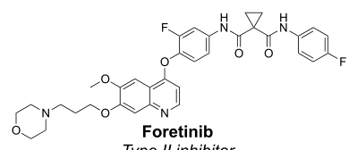

# XN Pipeline: Extracting Molecules from Scientific PDFs

Phase 2 pipeline of XN Project Group 5 (Computer Vision, Northeastern University). It turns molecule drawings, R-group tables, and synthesis schemes in medicinal chemistry papers into validated SMILES, and scores them against a curated answer key of 220 molecules from 6 papers.

## In plain terms

Chemistry papers describe new molecules mostly through **pictures**: structure drawings, tables, and reaction diagrams. Computers cannot search pictures, so this pipeline reads each paper the way a chemist would and writes every molecule out as **SMILES**, a short line of text that describes a molecule's structure (for example, `CCO` is ethanol). Once molecules are text, they can be searched, compared, and stored in databases.

To measure how well it works, every molecule the pipeline produces is checked against an **answer key**: a list of the 220 correct molecules from our 6 test papers.

**Headline result:** the Phase 1 baseline recovered 27.3% of the answer key exactly. The Phase 2 pipeline recovers **88.6%**, and 90.6% of what it outputs is correct.

### Key terms

| Term | Meaning |
|---|---|
| **SMILES** | A text code for a molecule's structure. One molecule can be written several ways, so we convert every SMILES to one standard ("canonical") form before comparing. |
| **Crop** | A small image cut out of a PDF page that contains one drawing. |
| **Scaffold** | A shared core structure drawn once, with labeled empty slots such as R1 and R2. |
| **R-group table** | A table listing what fills each slot for each compound. Scaffold + table row = one complete molecule. |
| **OCR** | Optical character recognition: reading text that appears inside an image. |
| **DPI** | Dots per inch, the resolution a PDF page is rendered at. Higher DPI means a sharper image. |
| **Recall** | Of the 220 answer key molecules, the share we recovered exactly. |
| **Precision** | Of everything the pipeline output, the share that was correct. |
| **Tanimoto** | A similarity score from 0 to 1 between two molecules. 1.0 means very similar, but not always identical (see Key finding 3). |

## Results

| Paper | Molecules | Phase 1 baseline | Phase 2 pipeline |
|---|---|---|---|
| 1 | 17 | 100.0% | 100.0% |
| 2 | 34 | 26.5% | **88.2%** |
| 4 | 60 | 23.3% | **80.0%** |
| 6 | 1 | 0.0% | 0.0% |
| 16 | 4 | 25.0% | 25.0% |
| 19 | 104 | 18.3% | **95.2%** |
| **All** | **220** | **27.3%** | **88.6%** |
| Precision | | 27.2% | **90.6%** |

Metric: exact structure recovery against 220 unique reference structures (duplicates within a paper removed), after RDKit canonicalization. Tanimoto similarity uses Morgan fingerprints (radius 2, 2048 bits) with chirality enabled.

## Understanding the results: recall and precision

### What the two numbers mean

Think of fishing in a lake that holds exactly 220 fish (the answer key):

1. **Recall** asks: *how many of the 220 fish did we catch?* It is the number of answer key molecules we recovered exactly, divided by 220. Phase 2 recovers 195 of 220, so recall is **88.6%**.
2. **Precision** asks: *how much of our catch is actually fish, and not boots and weeds?* It is the number of correct molecules we output, divided by everything we output. Phase 2's precision is **90.6%**, meaning about 9 in 10 of its outputs are real, correct molecules.

The two pull in different directions. A pipeline can raise recall by outputting more guesses, but extra guesses usually add junk and lower precision. A good pipeline needs both to be high.

**Exact match** is strict: a molecule counts only if the whole structure is identical, atom for atom. A prediction with one carbon missing scores zero.

### How assembly raised both at once

Normally, adding more outputs lowers precision. Here, both numbers rose together (recall 27.3% to 88.6%, precision 27.2% to 90.6%). The reason is what the baseline was outputting.

In the baseline, many of the detector's crops were not complete molecules at all: a scaffold with empty R slots, a single table cell holding just a substituent, or one piece of a larger molecule. The baseline reported each of these as a molecule, and each one counted as a wrong answer. That hurt precision, and the molecules those pieces belonged to were never recovered, which hurt recall.

Phase 2 changes this in two moves:

1. **Validation sorts the pieces out.** RDKit labels each reading as a complete molecule, a scaffold, a fragment, or a linker, so pieces are no longer reported as final answers. This removes wrong outputs, which raises precision.
2. **Assembly turns the pieces into molecules.** The same scaffolds, fragments, and linkers are combined using the paper's tables, schemes, and labels to build complete molecules. This adds correct outputs, which raises recall.

So the same crops that counted as wrong answers in the baseline became the raw material for right answers in Phase 2. The "Where the gains came from" table below shows this step by step: the first assembly stage alone lifted precision from 27.2% to about 83%.

### Paper by paper

| Paper | Molecules | Baseline correct | Phase 2 correct | Recall | Mean best Tanimoto |
|---|---|---|---|---|---|
| 1 | 17 | 17 | 17 | 100.0% | 1.000 |
| 2 | 34 | 9 | 30 | 88.2% | 0.948 |
| 4 | 60 | 14 | 48 | 80.0% | 0.937 |
| 6 | 1 | 0 | 0 | 0.0% | 0.932 |
| 16 | 4 | 1 | 1 | 25.0% | 0.592 |
| 19 | 104 | 19 | 99 | 95.2% | 0.991 |
| **All** | **220** | **60** | **195** | **88.6%** | |

**Mean best Tanimoto** answers a softer question than exact match: for each answer key molecule, how similar was our closest prediction (0 to 1)? A high value with low recall means our guesses were close but not exactly right. Precision is reported for all six papers combined (90.6%), not per paper.

**Paper 1: every molecule drawn in full (17 of 17, no change).** All 17 molecules appear as complete drawings, which is exactly what detection plus recognition handles well. The baseline already got them all, so there was nothing for assembly to add.

**Paper 2: one scaffold and an R-group table (9 to 30).** Most molecules are defined by a single core drawing plus a table of 21 substituents. The baseline could only read the parts separately. Phase 2 groups the table cells into rows, recovers cells the detector missed (`fill_cells.py`), reads small labels with targeted OCR, and joins each row to the scaffold. All 21 table compounds are now correct. The 4 misses are molecules outside the main table.

**Paper 4: large molecules drawn as pieces, plus a reaction scheme (14 to 48).** Many of these molecules (PROTACs) are drawn as separate parts: a warhead, a linker, and a ligand. Phase 2 joins the pieces, which recovered 17 of 17 compounds in Tables 1 and 3. Scheme 1 uses placeholders, including a blue letter C that stands for a linker, defined in a box and in text labels; reading the box, the blue color, and the labels added the rest. The 12 misses are listed under Remaining misses, and most come from notation the pipeline does not yet handle.

**Paper 6: a single molecule, read almost right (0 to 0).** The only molecule, NR-7h, was read with one methyl group in the wrong place. The Tanimoto of 0.932 shows the prediction was close, but exact match counts it as a miss. This is a recognition error, which assembly cannot repair.

**Paper 16: recognition errors (1 to 1).** Three of the four molecules were misread, for example with an extra methyl group. The low mean Tanimoto (0.592) shows some predictions were far from the answer. Like paper 6, these are reading mistakes on complete drawings, not shortcuts that assembly could fix.

**Paper 19: many tables in different formats (19 to 99).** The largest paper, with 104 molecules, almost all defined through tables. Each table format needed its own reader: plain text tables read directly from the PDF (Tables 1, 3, 6, 9), an image table where OCR was combined with the table's own rules (Table 7, 7 of 7), and a ruled grid with merged cells (Table 11, 25 of 25). Only 5 molecules are still missed, such as one with unspecified E/Z geometry (10e) and one where propyl was read as ethyl (B9).

**The pattern:** papers that rely on shortcuts (2, 4, 19) gained the most, because assembly was built for exactly that. Papers whose molecules are drawn in full (1, 6, 16) did not change, because their results depend only on recognition.

## Phase 1 baseline vs Phase 2: what changed and why

**The Phase 1 baseline** did two things: find each drawing on a page (detection with MolDetv2) and read it into SMILES (recognition with MolGlyph). That works when a paper draws each molecule in full, which is why paper 1 scored 100%.

**The problem:** most papers do not draw every molecule in full. To save space, chemists use shortcuts:

1. **Scaffold + table:** one core drawing with empty slots, and a table saying what goes in each slot for compounds 1, 2, 3, and so on.
2. **Separate pieces:** large molecules drawn as parts (a warhead, a linker, a ligand) that the reader mentally joins.
3. **Placeholders in reaction schemes:** a letter or colored symbol that stands for a group defined elsewhere in a box or text label.
4. **Abbreviations:** shorthand like `SO2C3H7` written instead of drawing the atoms.

The baseline reads each picture literally, so it cannot rebuild any of these. That is why it stopped at 27.3%.

**Phase 2** keeps the same detection and recognition models and adds the steps a chemist does in their head: reading tables, joining pieces, resolving placeholders, and expanding shorthand.

### How the Phase 2 pipeline works, step by step

1. **Find the drawings (Detection).** MolDetv2 scans each page and draws a box around every molecule drawing. Each box is saved as a crop.
2. **Read each drawing (Recognition).** MolGlyph looks at each crop and writes out its SMILES. Pages are rendered at 300 DPI so drawings are sharp.
3. **Check and sort (Validation).** RDKit, a chemistry toolkit, checks every SMILES and sorts it: a complete **valid** molecule, a **scaffold** with empty slots, a **fragment** or **linker** that is only a piece, or **invalid** (unreadable chemistry).
4. **Rebuild molecules that were not drawn whole (Assembly).** Scaffolds are combined with their tables, pieces are joined, and placeholders are filled in. Tables come in several forms (drawn, plain text, image, or ruled grid), and each has its own reader, using OCR where the text is inside an image.
5. **Expand shorthand (Abbreviations).** Labels MolGlyph could not draw out are replaced with their full structures.
6. **Score (Evaluation).** Every final molecule is compared with the answer key.

### Pipeline diagram

```
PDF pages
  └─ Detection (MolDetv2) ─> crops.csv
       └─ Recognition (MolGlyph, 300 DPI) ─> raw_predictions.csv
            └─ Validation (RDKit) ─> validated_predictions.csv
                 ├─ valid: complete molecules ──────────────────────────────────────┐
                 ├─ scaffold + drawn R-group table ─> assembly ─────────────────────┤
                 ├─ scaffold + text R-group table ─> assembly ──────────────────────┤
                 ├─ scaffold + image table (OCR + table logic) ─> assembly ─────────┤
                 ├─ scaffold + grid table (lines, merged cells, OCR) ─> assembly ───┤
                 ├─ warheads + linkers + ligand pieces ─> modular assembly ─────────┤
                 ├─ scheme placeholders + definition box ─> assembly ───────────────┤
                 ├─ scheme text labels (page OCR) ─> assembly ──────────────────────┤
                 └─ annotated wildcards ─> abbreviation expansion ──────────────────┤
                                                                                    └─> Scoring
```

### Where the gains came from

Each row adds one new step on top of the row before it.

| Stage added | Overall recall | Precision |
|---|---|---|
| Baseline (detection + recognition, 200 DPI) | 27.3% | 27.2% |
| + Paper 2 drawn R-group table, filled cells, targeted OCR | 36.8% | ~83% |
| + Paper 19 text tables (Tables 1, 3, 6, 9) | 56.8% | 87.3% |
| + Abbreviation expansion | 60.0% | 84.9% |
| + Recognition at 300 DPI | 60.5% | 86.8% |
| + Paper 4 assembly from drawn pieces (Tables 1, 3) | 67.3% | 88.0% |
| + Paper 19 Table 7: OCR combined with table logic | 70.5% | 88.4% |
| + Paper 19 Table 11: grid detection and merged cells | 81.4% | 89.8% |
| + Paper 4 Scheme 1: placeholders from the definition box and color | 85.0% | 90.3% |
| + Paper 4 Scheme 1: compounds defined by text labels | 88.6% | 90.6% |

Precision rose as recall climbed: each stage added real molecules, not noise.

### Code files for each stage

| Stage | File | What it does |
|---|---|---|
| Import baseline | `src/import_baseline.py` | Converts the Phase 1 run into the shared CSV interfaces |
| Rebuild crops | `src/rebuild_crops.py` | Re-creates crop images from PDFs and saved boxes, at any DPI |
| Recognition | `src/recognize.py` | MolGlyph on any list of images (Colab) |
| Validation | `src/validate.py` | Canonical SMILES plus a status: valid, invalid, scaffold, fragment, linker |
| Drawn table assembly | `src/assemble.py` | Groups fragment crops into table rows and columns by position, then joins them to the scaffold |
| Missed cells | `src/fill_cells.py` | Crops table cells that detection missed, for recognition |
| Table text | `src/read_table_text.py` | Targeted OCR of table text in images; dash detection by ink height (Colab) |
| Text table assembly | `src/text_tables.py` | Reads text tables from the PDF text layer; maps substituents, ring atoms, and linkers to structures |
| Image table columns | `src/read_columns.py` | Targeted OCR of text columns in image tables, one cell at a time (Colab) |
| Image table assembly | `src/image_tables.py` | Combines column OCR with table logic (consecutive entries, scaffold rules) |
| Table grid | `src/table_grid.py` | Detects a table's ruled lines, rows, columns, and merged cells from the image |
| Grid OCR | `src/grid_ocr.py` | OCR of grid cells, reading each merged cell once (Colab) |
| Grid table assembly | `src/grid_tables.py` | Vocabulary snapping, positional patterns, R2 assigned by merged cell, scaffold reused with bond cutting |
| Modular assembly | `src/pieces.py` | Joins separately drawn warheads, linkers, and ligand pieces |
| Scheme placeholders | `src/scheme_placeholders.py` | Resolves placeholder labels and blue placeholders with the scheme's definition box |
| Page OCR | `src/page_ocr.py` | Full-page OCR with positions, for text inside images (Colab) |
| Scheme labels | `src/scheme_labels.py` | Assembles compounds defined by labels like "19 R = Br; R1 = H" |
| Abbreviations | `src/expand_abbreviations.py` | Expands labels MolGlyph left as wildcards (e.g. SO2C3H7), using its own annotations |
| Scoring | `src/score.py`, `src/evaluate.py` | Final predictions, per paper and per molecule results |
| Error analysis | `src/error_analysis.py` | Classifies each missed molecule by how its closest prediction differs |
| Config B figures | `src/docling_figures.py` | Docling figure and table extraction with the benchmark's tuned settings (Colab) |
| Config B detection | `src/detect_figures.py` | MolDetv2 inside each figure, boxes mapped back to page positions (Colab) |
| Front end comparison | `src/compare_frontends.py` | Matches crops between two front ends by position; compares molecules found |
| Review | `src/review_crops.py` | Visual review sheets of crops by paper and status |
| All stages | `run_all.py` | Rebuilds every result in order |

Paper specific settings (table pages, scaffold and piece crops, slot mappings, linker direction, name patterns, scheme boxes) live in `config.yaml`, not in code.

## Inputs and outputs

Stages pass results to each other through CSV files. Every row is tied to its crop by `crop_id`, so each stage can be run and checked on its own.

| Stage | Input | Output | Key columns |
|---|---|---|---|
| Detection | PDF page images | `crops.csv` + crop images | `crop_id`, `paper_id`, `page`, box (`x1`, `y1`, `x2`, `y2`), `confidence`, `crop_path` |
| Recognition | `crops.csv` + crop images | `raw_predictions.csv` | `crop_id`, `raw_smiles`, `raw_output`, `inference_time`, `error` |
| Validation | `raw_predictions.csv` | `validated_predictions.csv` | `crop_id`, `canonical_smiles`, `status` (valid, invalid, scaffold, fragment, linker) |
| Assembly stages | `validated_predictions.csv` + `config.yaml` | `assembled_*.csv` (one per table or scheme) | built molecules per table or scheme |
| Abbreviation expansion | validated and assembled predictions | `expanded_predictions.csv` | expanded SMILES |
| Scoring | all predictions + `data/ground_truth.csv` | `final_per_molecule.csv`, `final_per_paper.csv` | `molecule_name`, `true_canonical`, `best_prediction`, `exact_match`, `best_tanimoto` |
| Error analysis | scoring outputs | `error_analysis.csv` | cause of each miss |

## Sample test case

One molecule from paper 1, page 3, followed through the pipeline (`results/A300/`).

**Input:** the detected crop (shown at 200 DPI; recognition used the 300 DPI rendering of the same box)



**Detection** (`crops.csv`): found on page 3 with confidence 0.955.

**Recognition** (`raw_predictions.csv`), 1.2 seconds:
`COc1cc2c(Oc3ccc(NC(=O)C4(C(=O)Nc5ccc(F)cc5)CC4)cc3F)ccnc2cc1OCCCN1CCOCC1`

**Validation** (`validated_predictions.csv`): RDKit parses it as a complete molecule, status `valid`.

**Scoring** (`final_per_molecule.csv`): matched to **Foretinib** in the answer key. Exact match: True, Tanimoto: 1.0.

## Technical methods

### Pretrained models

| Model | Used for | Why it was chosen |
|---|---|---|
| MolDetv2 (UniParser, YOLO11) | Finding molecule drawings on pages and in figures | Phase 1 baseline detector; version 2 reduces false positives on formulas and diagrams |
| MolGlyph (BioMiner, Yan et al., 2025) | Converting molecule images to SMILES | 72% exact match on clean BioVista images in our Phase 1 benchmark |
| Docling (Heron layout model) | Extracting figures and tables (Config B) | Used with the course benchmark's tuned settings |
| EasyOCR | Reading table text, labels, and scheme text | General purpose OCR that runs on the Colab GPU |

All models are used with their released pretrained weights. No fine tuning was done: our 220 molecules are also the answer key, so training on them would leave no fair data to score against.

### Data augmentation

None. Augmentation applies when training a model, and this pipeline trains none. Mirror flipping would also be unsafe for this task, because flipping a drawing with wedge bonds depicts the opposite enantiomer (the molecule's mirror image).

### Preprocessing

1. **Page rendering:** PDF pages rendered to images at 300 DPI (200 DPI in the baseline; 300 chosen after a controlled experiment).
2. **Config B framing:** Docling page images at scale 3.0, picture threshold 0.4, images under 5 KB dropped, white padding added before detection, and the whole image used as the crop when one detection covers at least 60% of it.
3. **Table grids:** ruled lines detected from the image to find rows, columns, and merged cells.
4. **Scoring:** RDKit canonical SMILES; Tanimoto with Morgan fingerprints (radius 2, 2048 bits, chirality on).

## Front end comparison: Config A vs Config B

The "front end" is the first part of the pipeline: how we find the molecule drawings before reading them. The Phase 2 plan tested two approaches.

**Config A: search the whole page.** MolDetv2 looks at each full PDF page (104 pages) and boxes every molecule it finds. This is the Phase 1 baseline approach. Think of scanning an entire newspaper page for photos.

**Config B: cut out figures first, then search inside them.** Docling, a document layout tool, first splits each page into its parts (text, figures, tables) and saves each figure and table as its own image (119 images). MolDetv2 then searches inside each of those images. Think of first cutting every picture box out of the newspaper, then looking closely at each one. Docling used the course benchmark's tuned settings (Heron layout model, page images at scale 3.0, picture threshold lowered from 0.5 to 0.4, images under 5 KB dropped), and MolDetv2 used the same settings as Config A.

**Why compare them?** Config B could help the detector by removing text and clutter, but it adds a step that might cut a drawing badly. We wanted to know which effect wins.

**Two versions of Config B.** In the first ("tight"), MolDetv2 ran directly on Docling's images. Because Docling crops tightly, drawings often touch the image edge, and the detector (trained on full pages) sometimes cut its boxes short. For example, paper 2's scaffold lost its R labels and was read as a complete molecule with methyl groups. The second version ("padded") adds a white border around each image before detection, and uses the whole image as the crop when one detection already covers at least 60% of it.

To keep the comparison fair, all three runs were scored with the general stages only (no per paper settings), so the only thing that differs is the front end.

| | Config A | Config B, tight | Config B, padded |
|---|---|---|---|
| Images searched | 104 full pages | 119 figures and tables | 119 figures and tables |
| Crops detected | 235 | 268 | 266 |
| Config A crops also found by B | | 230 of 235 | 232 of 235 |
| **Recall (general stages)** | **30.9%** | **30.9%** | **30.0%** |
| Precision (general stages) | 78.8% | 76.0% | 72.3% |
| Paper 2 cells missed on full pages, found here | | 20 of 21 | 19 of 21 |
| **Paper 2 table assembled with no recovery step** | No (needs `fill_cells.py`) | No (scaffold clipped) | **Yes, 21 of 21 correct** |

**What we learned:**

1. **For complete molecules, the front end barely matters.** All three runs recover almost the same number of molecules. Once a good molecule detector is in place, finding the drawings is no longer the bottleneck.
2. **Config B helps with tables.** On full pages, MolDetv2 missed 21 small cells in paper 2's table, and Config A needed a separate repair step (`fill_cells.py` plus an extra recognition run) to recover them. When the detector sees the table as its own image, it finds those cells directly, and with padding the whole table assembles correctly (21 of 21) with no repair step.
3. **How a drawing is framed changes how it is read.** Small changes in cropping changed which molecules MolGlyph read correctly. AST487 (paper 1) was lost in both Config B versions, the same Docling cropping failure the course benchmark reported. B9 (paper 19), misread from Config A's crop, was read correctly from the tight Config B crop but not the padded one, and JB170 (paper 4) was lost only with padding. There is no single best cropping rule, but comparing readings across framings could be used to flag recognition errors.

**Bottom line:** Config A remains the default because it matches Config B on recall with higher precision. Config B is worth using for dense tables, where it removes a manual repair step.

## How well would this work on a new paper? (ablation)

Many stages need per paper settings in `config.yaml` (for example, which crop is a table's scaffold and which slot is Ra). Those settings were developed on these six papers with the answer key visible, so the 88.6% result is a development score, like practicing on the exam you are graded on. To estimate performance on an unseen paper, the pipeline was rerun with only the stages that need no per paper settings: recognition, validation, and abbreviation expansion (`config_general.yaml`).

| System | Recall | Precision |
|---|---|---|
| ChatGPT-5.5 High (course benchmark) | 14.4% | 0.6% |
| Claude Code (course benchmark) | 6.3% | 25.9% |
| **This pipeline, general stages only** | **30.9%** | **78.8%** |
| This pipeline, configured per paper | 88.6% | 90.6% |

Agent figures are totals across the six papers (32 of 222 and 14 of 222 correct), computed from the course benchmark's table; its Claude Code precision and recall columns appear to be swapped, and are recomputed here from its counts.

Two cautions: the general stages were also refined on these papers (the abbreviation vocabulary, the 300 DPI choice, fuzzy matching thresholds), so 30.9% is a close estimate rather than a true held out score; and the benchmark's other 14 papers are deliberately undisclosed by its authors, so a true held out test needs new papers with a new answer key.

The 57.7 point gap between the two pipeline rows shows how much value comes from understanding each paper's layout, and it is the target for future automation: about 11 configuration entries unlock 127 molecules.

## Key findings

1. **Recognition is not the main bottleneck.** When MolGlyph sees a complete molecule, it is right about 73% of the time, matching its clean-image benchmark (72%). Most losses came from molecules that were never drawn whole: scaffold + table, separate pieces, or placeholders in reaction schemes.
2. **Building from pieces can beat reading the whole drawing.** CCT400028's full drawing was read with one carbon missing from a long chain. The same chain, drawn on its own in another table, was read correctly, and joining the pieces recovered the exact molecule.
3. **A Tanimoto of 1.0 does not guarantee the same molecule.** The fingerprint used for Tanimoto cannot tell a chain of four CH2 groups from a chain of five. This is why exact match is the headline metric.
4. **OCR alone is unreliable on tiny table cells; OCR plus the table's own logic works.** In paper 19 Table 7, raw OCR swapped or missed scaffold letters and added stray digits to entry numbers. Combining it with the table's structure (entries are consecutive; "a dash means scaffold B") gave 7 of 7 correct. Matching garbled text to a small list of expected labels did the same for Table 11's R1 column.
5. **A position label means nothing without knowing where counting starts.** Table 11's "2,4-diF" and "2,6-diF" count ring positions from the sulfonamide side (as in vemurafenib's official name). Counting from the other side swapped every pair of compounds; the answer key exposed this immediately.
6. **Color carries meaning that recognizers ignore.** In paper 4 Scheme 1, a blue letter C stands for a linker, not a carbon atom. Detecting blue pixels identified these placeholders, which MolGlyph had read as ordinary unknown groups.
7. **Higher resolution helps only a little.** A controlled experiment (same crop boxes and model, 200 vs 300 DPI) gained 1 molecule and lost none, but did not fix miscounted chains or misplaced groups. 300 DPI is the default because it was strictly better on exact match.
8. **Most remaining misses are not vision errors.** An automatic error analysis (`src/error_analysis.py`) of the 25 remaining misses found about 14 caused by notation the pipeline does not yet handle, 2 by how the answer key represents a molecule (a salt, an unspecified double bond), and only about 6 genuine recognition errors, roughly 3% of all molecules.

## Quick start

```bash
conda create -n biobench -c conda-forge --override-channels python=3.10 -y
conda activate biobench
pip install -r requirements.txt
python run_all.py
```

`run_all.py` rebuilds every result from the committed inputs on a laptop CPU, in about a minute. Rebuilding is deterministic: the output files are byte for byte identical to the committed ones. Results go to `results/A300/` by default. To run the general stages only (no per paper settings): `python run_all.py --config config_general.yaml --results results/G`.

**Data:** place the PDFs in `data/pdfs/` (named `<paperID>.pdf`) and the answer key at `data/ground_truth.csv`. Both are excluded from Git.

**GPU stages** run on Google Colab, and their outputs are committed, so `run_all.py` does not need a GPU: MolGlyph recognition (`src/recognize.py`) and the OCR tools (`src/read_table_text.py`, `src/read_columns.py`, `src/grid_ocr.py`, `src/page_ocr.py`). See [colab_setup.md](colab_setup.md).

## How results were verified

Every assembly stage was checked against the answer key in at least one of these ways:

1. **By name:** where compound numbers are readable, each built molecule is compared with the reference of the same name.
2. **By structure:** where names are unreadable, each built molecule is matched against the whole paper's answer key, which reveals the name it corresponds to.
3. **Self tests:** known compounds rebuilt by a new route must match exactly (vemurafenib from three different scaffolds; 11a, 11b, and 16 rebuilt by Table 11's route).
4. **Cross route checks:** compound 44 in paper 4 was built from two different tables, and both routes produced the identical molecule.

## Design decisions and known limitations

1. **Slot mappings are verified per table.** MolGlyph's wildcard numbers do not always match a table's R labels. Every mapping in `config.yaml` was confirmed by a self test and by name or structure.
2. **Directions and orientations were tested, not assumed.** Paper 19 Table 3's linker direction was settled by running both directions; paper 4's two-ended linkers are oriented by a chemical rule (the end on N joins the ligand's carbonyl), confirmed on all 7.
3. **Pieces and scaffolds may be reused across tables** when a table's own drawing failed recognition (paper 4 Table 1, paper 19 Table 11), always with a self test.
4. **Inferred values are flagged, never hidden:** an entry number filled from a consecutive run (Table 7's compound 13), an R2 taken from a neighboring merged cell (Table 11's compound 38), and a blue placeholder resolved as linker C (Scheme 1's compounds 27 and 30). All were confirmed by the answer key.
5. **The pipeline refuses rather than guesses.** A compound whose scaffold has an unresolved label is skipped with the reason recorded (Scheme 1's compounds 36 and 37), rather than built wrong.
6. **Generic compounds are kept as wildcards** (e.g. "Heteroaryl/Aryl"), because the answer key stores them that way. Only full size structures with one generic attachment point count.
7. **Fuzzy label matching is limited and audited.** Misread labels are matched to known ones only at 75% similarity or more, and only for labels of 4 or more characters. Every match is recorded.
8. **Open decision: compound 10e** (paper 19). The table writes `CH=CH` without E/Z geometry; the answer key uses E. Left as a known miss pending a documented default.

### Remaining misses (25)

| Paper | Missed | Cause |
|---|---|---|
| 4 | 12 | Blue C read as an ordinary carbon (15, 16, 28, 32); repeated units in brackets (36, 37); a salt (18); named literature PROTACs (JB300, SK2188, dAURK-4, PROTAC-D); 50 |
| 19 | 5 | E/Z geometry (10e), propyl read as ethyl (B9), and a few others |
| 2 | 4 | Molecules outside the main table |
| 16 | 3 | Recognition errors (e.g. an extra methyl) |
| 6 | 1 | A misplaced methyl (NR-7h) |

Only about 6 of these are genuine recognition errors; the rest come from notation the pipeline does not yet handle (see Key finding 8).

## Repository layout

```
config.yaml          data paths, BioMiner paths, table and scheme settings
config_general.yaml  the same with no per paper settings (general stages only)
run_all.py           rebuild all results
src/                 pipeline stages
results/A/           200 DPI run (Phase 1 baseline crops + early Phase 2 stages)
results/A300/        300 DPI run (current default, all stages)
results/G/           Config A, general stages only
results/B/           Config B (Docling + padded MolDetv2), general stages only
results/B_tight/     Config B without padding (first variant), general stages only
docs/                images used in this README
data/                PDFs and answer key (not in Git)
colab_setup.md       GPU stages on Colab
```

## Credits

Models: MolDetv2 (UniParser) and MolGlyph (BioMiner, Yan et al., 2025); chemistry with RDKit; OCR with EasyOCR.
